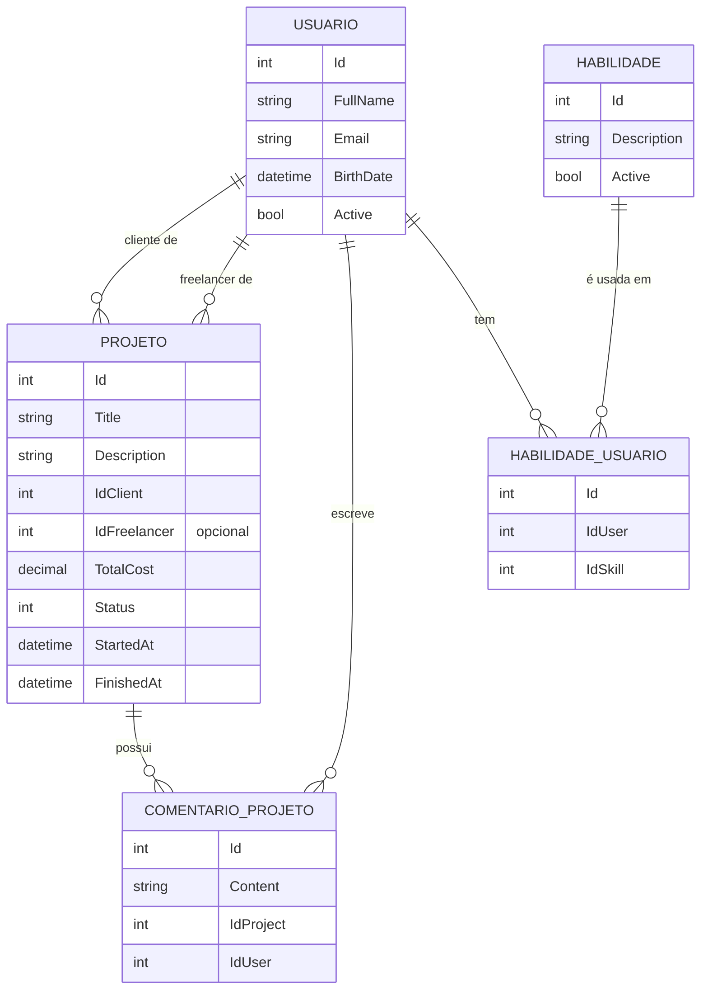

# DevFreela API


API REST de uma plataforma de **freelancers**: clientes publicam projetos, freelancers são atribuídos a eles e os dois conversam por comentários.
Projeto de estudo construído em **ASP.NET Core 10**, com **Clean Architecture**, **CQRS com MediatR**, **Repository Pattern** e **validação com FluentValidation**.

---

## Sumário

- [Funcionalidades](#funcionalidades)
- [Tecnologias](#tecnologias)
- [Arquitetura](#arquitetura)
- [Padrões aplicados](#padrões-aplicados)
- [Modelo de dados](#modelo-de-dados)
- [Endpoints](#endpoints)
- [Como executar](#como-executar)
- [Exemplos de uso](#exemplos-de-uso)
- [Próximos passos](#próximos-passos)
- [Autor](#autor)

---

## Funcionalidades

**Projetos**
- Cadastrar, editar, listar (com busca por texto) e detalhar projetos
- Ciclo de vida com regras de negócio na entidade: **Criado → Em andamento → Concluído**, com opção de **Cancelar**
- Comentários em projetos

**Usuários**
- Cadastrar, editar, listar e detalhar usuários (com suas skills)
- Desativação lógica (*soft delete*)

**Skills**
- Cadastrar, editar, listar e desativar habilidades

**Validação e erros**
- Commands validados automaticamente antes de chegar ao handler
- Erros devolvidos no padrão **ProblemDetails** (RFC 9110), com a lista de campos inválidos

---

## Tecnologias

| Categoria | Tecnologia |
|---|---|
| Linguagem / Framework | C# · ASP.NET Core 10 (Web API) |
| Banco de dados | PostgreSQL |
| ORM | Entity Framework Core 10 + Npgsql |
| Mensageria interna (CQRS) | MediatR |
| Validação | FluentValidation |
| Documentação | OpenAPI + Swagger UI |

---

## Arquitetura

A solução segue os princípios da **Clean Architecture**: as dependências apontam para dentro, e o domínio não conhece banco de dados nem HTTP.

```
┌──────────────────────────────────────────────┐
│  DevFreela.API             (Controllers, HTTP)│
│  ┌────────────────────────────────────────┐  │
│  │  DevFreela.Application                 │  │
│  │  (Commands, Queries, Validators, VMs)  │  │
│  │  ┌──────────────────────────────────┐  │  │
│  │  │  DevFreela.Core (Domínio)        │  │  │
│  │  │  Entidades, Enums, Interfaces    │  │  │
│  │  └──────────────────────────────────┘  │  │
│  └────────────────────────────────────────┘  │
│  DevFreela.Infrastructure  (EF Core, Repos)  │
└──────────────────────────────────────────────┘
```

| Projeto | Responsabilidade |
|---|---|
| **DevFreela.API** | Controllers, configuração da aplicação (`Program.cs`) e tratamento global de exceções |
| **DevFreela.Application** | Casos de uso: commands, queries, handlers do MediatR, validators e view models |
| **DevFreela.Core** | Domínio: entidades com regras de negócio, enums e interfaces dos repositórios |
| **DevFreela.Infrastructure** | Persistência: `DbContext`, mapeamentos (Fluent API), migrations e implementação dos repositórios |

```
DevFreela/
├── DevFreela.API/
│   ├── Controllers/
│   └── ExceptionHandlers/
├── DevFreela.Application/
│   ├── Behaviors/          # ValidationBehavior (pipeline do MediatR)
│   ├── Commands/           # escrita: CreateProject, StartProject, CreateUser...
│   ├── Queries/            # leitura: GetAllProject, GetByIdUser...
│   └── ViewModels/
├── DevFreela.Core/
│   ├── Entities/
│   ├── Enums/
│   └── Repositories/       # interfaces
└── DevFreela.Infrastructure/
    └── Persistence/
        ├── Configurations/ # mapeamento das entidades
        ├── Migrations/
        └── Repositories/   # implementações
```

---

## Padrões aplicados

### CQRS com MediatR
Leitura e escrita são separadas em **Queries** e **Commands**. O controller só envia a requisição para o MediatR, que encontra o handler certo:

```csharp
[HttpPut("{id}/start")]
public async Task<IActionResult> Start(int id)
{
    var started = await _mediator.Send(new StartProjectCommand { Id = id });
    return started ? NoContent() : NotFound();
}
```

### Repository Pattern
Os handlers dependem de **interfaces** definidas no domínio (`IProjectRepository`, `IUserRepository`, `ISkillRepository`). A implementação com EF Core fica na Infrastructure, então trocar a forma de persistência não afeta as regras de negócio.

### Validação no pipeline (FluentValidation + MediatR Behavior)
Um `IPipelineBehavior` genérico roda os validators de cada command **antes** do handler. Se houver erro, o handler nem é executado, e um `IExceptionHandler` transforma a exceção em **400 Bad Request**:

```csharp
public class CreateProjectCommandValidator : AbstractValidator<CreateProjectCommand>
{
    public CreateProjectCommandValidator()
    {
        RuleFor(p => p.Title)
            .NotEmpty().WithMessage("Título é obrigatório.")
            .MinimumLength(6).WithMessage("O título precisa ter mais de 5 caracteres.");
    }
}
```

### Domínio rico
As regras de estado ficam na própria entidade, e não espalhadas pelos handlers:

```csharp
public void Start()
{
    if (Status == ProjectStatusEnum.Created)
    {
        Status = ProjectStatusEnum.InProgress;
        StartedAt = DateTime.UtcNow;
    }
}
```

### Outras práticas
- **Soft delete** em usuários e skills (desativação em vez de exclusão física)
- **`AsNoTracking`** nas consultas de leitura e consultas separadas para commands, evitando rastreamento desnecessário
- **View models** para não expor entidades do domínio na API
- **Datas em UTC**, compatíveis com o PostgreSQL (`timestamp with time zone`)

---

## Modelo de dados



**Status do projeto** (`ProjectStatusEnum`): `0` Criado · `1` Em andamento · `2` Suspenso · `3` Cancelado · `4` Concluído

---

## Endpoints

### Projetos — `/api/projects`

| Método | Rota | Descrição | Respostas |
|---|---|---|---|
| `GET` | `/api/projects?query=` | Lista projetos (busca opcional) | 200 |
| `GET` | `/api/projects/{id}` | Detalhes, cliente, freelancer e comentários | 200 · 404 |
| `POST` | `/api/projects` | Cria um projeto | 201 · 400 |
| `PUT` | `/api/projects/{id}` | Atualiza título, descrição e custo | 204 · 400 · 404 |
| `DELETE` | `/api/projects/{id}` | Cancela o projeto | 204 · 404 |
| `PUT` | `/api/projects/{id}/start` | Inicia o projeto | 204 · 404 |
| `PUT` | `/api/projects/{id}/finish` | Conclui o projeto | 204 · 404 |
| `POST` | `/api/projects/{id}/comments` | Adiciona um comentário | 204 · 400 · 404 |

### Usuários — `/api/users`

| Método | Rota | Descrição | Respostas |
|---|---|---|---|
| `GET` | `/api/users` | Lista usuários ativos | 200 |
| `GET` | `/api/users/{id}` | Detalhes com skills | 200 · 404 |
| `POST` | `/api/users` | Cadastra um usuário | 201 · 400 |
| `PUT` | `/api/users/{id}` | Atualiza nome e e-mail | 204 · 400 · 404 |
| `DELETE` | `/api/users/{id}` | Desativa o usuário | 204 · 404 |

### Skills — `/api/skills`

| Método | Rota | Descrição | Respostas |
|---|---|---|---|
| `GET` | `/api/skills` | Lista skills ativas | 200 |
| `GET` | `/api/skills/{id}` | Detalhes de uma skill | 200 · 404 |
| `POST` | `/api/skills` | Cadastra uma skill | 201 · 400 |
| `PUT` | `/api/skills/{id}` | Atualiza a descrição | 204 · 400 · 404 |
| `DELETE` | `/api/skills/{id}` | Desativa a skill | 204 · 404 |

---

## Como executar

### Pré-requisitos
- [.NET SDK 10](https://dotnet.microsoft.com/download)
- [PostgreSQL](https://www.postgresql.org/download/)
- Ferramenta do EF Core: `dotnet tool install --global dotnet-ef`

### Passo a passo

```bash
# 1. Clonar o repositório
git clone https://github.com/josuegutilla/DevFreela.git
cd DevFreela

# 2. Configurar a connection string (sem expor a senha no repositório)
cd DevFreela.API
dotnet user-secrets init
dotnet user-secrets set "ConnectionStrings:DevFreelaCs" "Host=localhost;Port=5432;Database=dev_freela;Username=postgres;Password=SUA_SENHA"
cd ..

# 3. Criar o banco e as tabelas
dotnet ef database update -p DevFreela.Infrastructure -s DevFreela.API

# 4. Rodar a API
dotnet run --project DevFreela.API --launch-profile https
```

A API sobe em `https://localhost:7074`. A documentação interativa fica em **`https://localhost:7074/swagger`**.

---

## Exemplos de uso

**Criar um projeto**

```http
POST /api/projects
Content-Type: application/json

{
  "title": "API de pagamentos com Pix",
  "description": "Integração com PSP, webhooks e conciliação diária.",
  "idClient": 1,
  "idFreelancer": 2,
  "totalCost": 32000
}
```

**Resposta de validação (400)**

```json
{
  "type": "https://tools.ietf.org/html/rfc9110#section-15.5.1",
  "title": "One or more validation errors occurred.",
  "status": 400,
  "errors": {
    "Title": ["O título precisa ter mais de 5 caracteres."]
  }
}
```

---

## Próximos passos

- [ ] Autenticação e autorização com **JWT** (login, hash de senha com BCrypt, roles cliente/freelancer)
- [ ] Autorização por recurso (só o cliente dono pode editar o projeto)
- [ ] Endpoint para vincular skills a um usuário
- [ ] Testes unitários (xUnit + Moq) para handlers e validators
- [ ] Paginação na listagem de projetos
- [ ] Logs estruturados (Serilog)
- [ ] Docker + docker-compose (API + PostgreSQL)
- [ ] Pipeline de CI com GitHub Actions

---

## Autor

**Josué Gutilla**

[](https://github.com/josuegutilla)
